# SetFluence — Festival Sponsorship Studio

**SetFluence** is an evidence-backed festival sponsorship planning studio that turns a multi-stage artist lineup and commercial rulebook into an executive-ready, stage-by-stage partnership deck. It combines **Qloo Cultural AI** (live artist-to-brand affinity, stage-targeted brand discovery, and music/lifestyle cultural tags) with a **deterministic constraint solver** and a **bounded agentic recovery loop**.

---

## 1. Studio Walkthrough (60-Second Guide)

SetFluence is designed as a desktop sponsorship studio with persistent left-hand stage navigation and version history.

### Step 1 — Choose a Scenario & Run Qloo Match
1. In the left sidebar under **Festival Scenario**, select one of the three built-in festival briefs:
   - **Horizon Multi-Genre** (Indie, Electronic, and Hip-Hop/R&B stages with apparel exclusivity)
   - **Neon Pulse Electronic** (Progressive Synth, Club, and Vinyl Chillout stages with energy drink exclusivity)
   - **Constraint Stress-Test** (Exclusivity + stage-level category restrictions)
2. Optionally open **Festival Brief & Rules** in the sidebar to customize stage lineups, physical capacity tiers (`Main Headliner Arena`, `Secondary Stage`, `Intimate Tent & Lounge`), footprints (`compact`, `medium`, `large`), or add rules via the structured **3-Part Commercial Rule Builder** (*Rule Type* $\to$ *Category / Brand* $\to$ *Stage or Festival Scope*).
3. Click **Run Qloo Match** in the sidebar. SetFluence resolves the performing artists against Qloo, discovers stage-specific candidate brands for each stage's lineup, computes shortlist fit scores (`0.580–1.000 Fit`), and solves the optimal festival-wide sponsor allocation (`v1`).

### Step 2 — Inspect Stages & Run Live What-If Simulations
Click any stage under **Stages (Focus View)** in the left sidebar to open its master-detail workspace:
- **Recommended Stage Partner & Standby Backup:** Shows the winning primary sponsor, stage fit score (`0.580–1.000 Fit`), artist coverage ratio (`3/3 artists covered`), pre-vetted standby sponsor, and cross-stage placement rationale.
- **Interactive Right-Hand Brand Leaderboard:** Lists the candidate brands evaluated for this specific stage (combining the organizer's cross-stage target pool with Qloo's stage-specific discoveries). **Click any brand in the leaderboard** to immediately compare it head-to-head against the stage winner across every performing artist.
- **Artist-by-Artist Qloo Affinity Proof:** Visualizes how each artist on the stage ranks the winning sponsor versus the selected challenger (`#1/7`, `+0.112 Fit` lead), backed by live Qloo signals.
- **Instant Stage Simulations:** Click **Lock Deal**, **Simulate Drop-Out**, or **Restrict [Category]** directly on the stage card. A live recalculation banner tracks the bounded agent as it re-runs the deterministic solver (and automatically invokes `investigateUnfilledStage` to discover a new Qloo replacement brand if a stage becomes unfilled), producing a new plan version (`v2`, `v3`, ...) with a full diff log.
- **Suggested Activation Directions (Brainstorm Spec):** Translates the stage's physical envelope and Qloo cultural/lifestyle tags into exploratory creative directions, complete with **3 selectable On-Site Fan Immersion Options** (`Option 1`, `Option 2`, `Option 3`) and a commercial verification checklist.

### Step 3 — Explore the 2-Part Brand × Stage Matrix
Click **Brand × Stage Matrix** in the left sidebar to inspect festival-wide routing at a glance:
- **Part 1 — Cross-Stage Exclusivity & Routing Matrix:** Displays the organizer's shared target brands across all 3 stages (`WINNER`, `STANDBY`, `RULE BLOCKED`, `ELIGIBLE`), making cross-stage category exclusivity trade-offs immediately transparent.
- **Part 2 — Stage-Tailored Qloo Brand Discoveries:** A 3-column stage grid underneath showing the candidate brands Qloo discovered specifically for each individual stage's artist lineup. Clicking any card jumps straight to that stage's head-to-head comparison.

### Step 4 — Compare LLM vs. Qloo Benchmark, Audit Trail & Print 3-Stage Deck
- **LLM vs. Qloo Benchmark:** Click **LLM vs. Qloo Benchmark** in the left sidebar to run a controlled side-by-side comparison (*Condition A: Ungrounded LLM + Deterministic Solver* vs. *Condition B: SetFluence + Qloo Cultural AI + Deterministic Solver*) on the exact same brief and candidate pool—isolating how empirical Qloo artist affinities overturn generic genre stereotypes and provide `100%` claim-to-source traceability.
- **Qloo & Solver Audit:** Inspect the step-by-step tool execution timeline (`resolveLineup`, `discoverBrands`, `evaluateShortlistFit`, `runPlanner`, `investigateUnfilledStage`) with execution timings and version-over-version allocation diffs.
- **Print PDF (Full 3-Stage Executive Deck) & Markdown Export:** Click **Print PDF** in the sidebar footer from anywhere in the workspace to generate a formatted, multi-page **3-Stage Executive Sponsorship Deck** covering the festival summary table, active commercial rules, and dedicated page-break briefs for all 3 stages.

---

## 2. System Architecture & Intelligence Pipeline

```mermaid
flowchart LR
  Brief["Festival Brief & Rules\n(3 Stages, Artists, Envelopes)"] --> Agent["Bounded Orchestrator\n(backend/src/agent)"]
  Agent -->|1. resolveLineup & discoverBrands| Qloo["Qloo Cultural AI API\n(/v2/insights & /v2/tags)"]
  Qloo -->|Raw Affinity & Cultural Tags| Scoring["Shortlist Fit Normalizer\n(0.580 - 1.000 Fit Curve)"]
  Scoring -->|Stage-Targeted Evidence| Solver["Deterministic Constraint Solver\n(backend/src/solver)"]
  Solver -->|Unfilled Stage Detected| Agent
  Solver -->|Optimal 3-Stage Allocation| BriefSynth["Suggestive Activation Spec\n(3 Fan Immersion Options)"]
  BriefSynth --> UI["SetFluence Studio UI\n(React + Vite + Print Deck)"]
```



### Strict Architectural Separation
1. **Qloo Cultural Intelligence ([`backend/src/services/qloo.service.ts`](backend/src/services/qloo.service.ts)):**
   - Resolves artist and brand entities against live Qloo endpoints (`https://hackathon.api.qloo.com`), discovers stage-targeted brand candidates per stage lineup, queries artist-to-brand affinity scores, and retrieves music/lifestyle tags (`/v2/tags`).
   - Normalizes raw Qloo affinities into positive shortlist fit scores (`0.580–1.000 Fit`) that preserve strict per-artist rank order while reflecting pre-qualified cultural fit.
2. **Deterministic Constraint Solver ([`backend/src/solver/planner.ts`](backend/src/solver/planner.ts) & [`constraints.ts`](backend/src/solver/constraints.ts)):**
   - All mathematical and commercial constraints—**Festival-Wide Category Exclusivity**, **Stage/Festival Category Restrictions**, **Locked Stage Placements**, **Sponsor Availability**, and **Stage Physical Envelopes**—are evaluated 100% deterministically in TypeScript. The LLM never guesses or overrides constraint math.
   - Performs global combinatorial optimization across all stages simultaneously, ensuring no brand is double-booked as primary sponsor and minimizing allocation churn during revisions.
3. **Bounded Research, Recovery & Benchmark Engine ([`backend/src/agent/orchestrator.ts`](backend/src/agent/orchestrator.ts) & [`benchmark.ts`](backend/src/agent/benchmark.ts)):**
   - Orchestrates a bounded tool loop (`maxSteps = 8`) with deterministic completion guarantees.
   - Includes a controlled benchmark runner (`POST /api/plans/benchmark`) that evaluates an ungrounded LLM baseline through the exact same `runPlanner` solver to prove the empirical value of Qloo grounding.

### Repository Layout

```text
setfluence/
├── shared/                 Shared TypeScript domain contracts (@setfluence/shared)
│   └── src/index.ts        Domain types, solver contracts & benchmark schemas
├── backend/                Fastify API, QlooService, solver & agent (@setfluence/backend)
│   └── src/
│       ├── agent/          Orchestrator, bounded tools & controlled LLM benchmark runner
│       ├── services/       Live Qloo API client, caching & shortlist fit normalization
│       ├── solver/         Deterministic constraint evaluation & multi-stage planner
│       └── index.ts        Fastify server (REST API + static production SPA hosting)
├── frontend/               React 19 + Vite desktop studio UI (@setfluence/frontend)
│   └── src/
│       ├── components/     SponsorMatrix, BenchmarkComparison, AgentTimeline, PrintExecutiveDeck
│       ├── data/           Preset festival scenarios & sponsor category catalog
│       ├── utils/          Formatters, fan activity resolver & Markdown exporter
│       ├── api.ts          Typed backend API client
│       ├── App.tsx         Studio workspace shell, setup view & stage focus view
│       └── styles.css      Light pastel desktop theme & @media print executive deck
├── Dockerfile              Multi-workspace production container
└── render.yaml             Cloud deployment blueprint
```

---

## 3. Quickstart & Commands

### Prerequisites
- **Node.js `>= 22.18.0`** (Node 22.18+ or Node 24 recommended for native TypeScript execution)
- **npm `>= 10`**

### 1. Install Dependencies & Configure Environment

```bash
cp .env.example .env
npm install
```

Update `.env` with your credentials:

```env
QLOO_API_KEY=your_qloo_hackathon_api_key
QLOO_BASE_URL=https://hackathon.api.qloo.com
GEMINI_API_KEY=your_gemini_api_key_optional_for_creative_synthesis
PORT=3001
```

*(Note: If `GEMINI_API_KEY` is omitted, SetFluence automatically uses its deterministic tool loop and Qloo-grounded activation synthesizer so all features remain 100% functional.)*

### 2. Build & Start Production Studio (Single Port `3001`)

```bash
npm run build
npm start
```

Open **`http://localhost:3001`** in your browser. Fastify serves both the compiled React studio and the `/api/*` endpoints on port `3001`.

### 3. Development, Typecheck & Test Commands

```bash
# Run full monorepo TypeScript contract verification (shared + backend + frontend)
npm run typecheck

# Run unit & integration test suite (Solver, Bounded Agent Loop, Controlled Benchmark, Fastify E2E)
npm test

# Run backend or frontend dev servers individually
npm run dev:backend
npm run dev:frontend
```

---

## License

MIT — see [LICENSE](LICENSE). Brand names and external cultural data retain their respective owners' terms.
